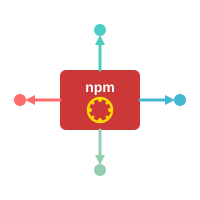

<p align="center">
  
</p>

<h1 align="center">Always Up To Date</h1>

<p align="center">
  Dependency updates that respect your package.json: ranges are followed, exact pins stay put, and you decide how far past them to go.
</p>

<p align="center">
  <a href="https://github.com/pixel-perfect-software/always-up-to-date/actions/workflows/ci.yml"></a>
  <a href="https://www.npmjs.com/package/@pixel-perfect-software/always-up-to-date"></a>
  
  
  
  <a href="LICENSE"></a>
</p>

`autd` updates your dependencies the way your package manager would. Run `autd update` and each
dependency moves to the newest version its package.json range allows, the same set `npm update`
installs, while an exact pin like `"18.2.0"` stays exactly where it is. When you want more, a
small config file lets one package, a scope, or everything move past its range.

It works with npm, pnpm, yarn and bun, in single projects and workspaces, and uses the package
manager your package.json declares, or the one your lockfile belongs to.

```console
$ autd update --dry-run

Would update (15)
  axios      1.4.0   → 1.20.0
  commander  9.0.0   → 9.5.0
  debug      4.3.1   → 4.3.7
  zod        3.20.0  → 3.25.76
  …

Would skip (5)
  express     4.17.1 → 5.3.0   (major beyond the range)
  react       18.2.0 → 19.3.1  (major beyond the range)
  typescript  5.0.4  → 7.0.2   (major beyond the range)
  …
```

What happens to each kind of spec:

| In package.json | Installed | Latest | `autd update` | With `"beyondRange": "major"` |
|---|---|---|---|---|
| `"^9.0.0"` | 9.0.0 | 15.0.0 | 9.5.0, the newest `9.x` | `"^15.0.0"` |
| `"~4.3.1"` | 4.3.1 | 4.4.3 | 4.3.7, the newest `4.3.x` | `"~4.4.3"` |
| `"18.2.0"` | 18.2.0 | 19.3.1 | stays on 18.2.0 | `"19.3.1"`, still exact |

## ✨ Features

- 📏 **Follows your ranges.** By default an update installs what the package manager itself would, and an exact pin is never touched.
- 🎚️ **Goes further when you say so.** `beyondRange` lets everything move past its range by a patch, minor or major step; per-package `rules` hold a package, keep it in range, or always take the latest, by name or `*` glob.
- 🛡️ **Holds what would break.** A package your package manager pins with an override is left alone, and so is an update an installed package's peer range would reject. Each one is reported with the reason.
- ⏳ **Waits out fresh releases.** `cooldown` skips versions published more recently than a number of days, a duration like `"1 week"`, or a limit per update type.
- ✍️ **Keeps package.json yours.** Decorators, `npm:` aliases and compound ranges keep their shape, and the file keeps its indentation, line endings and final newline.
- 🤖 **Fits in CI.** `--json` prints nothing but JSON, and a failed step exits 1 with its name.

## 📋 Requirements

- **Node.js** 24 or higher
- **npm**, **pnpm**, **yarn** v1 or **bun**. yarn 2+ (berry) isn't supported yet ([#79](https://github.com/pixel-perfect-software/always-up-to-date/issues/79)).

## 🚀 Install

```bash
npm install -g @pixel-perfect-software/always-up-to-date
```

The command is `autd`; `alwaysuptodate` and `always-up-to-date` work too.

## 🧭 Getting started

```bash
autd check              # list outdated dependencies
autd update --dry-run   # see where each one would move, or why it's held
autd update             # apply it
autd init               # optional: create .always-up-to-date.json to go past your ranges
```

## ⌨️ Commands

| Command | Description |
|---------|-------------|
| `autd check` | List outdated dependencies |
| `autd check --json` | The same, as JSON |
| `autd update` | Update every eligible dependency |
| `autd update [packages...]` | Update only the named packages |
| `autd update --dry-run` | Show where each package would move, or why it's held, without changing anything |
| `autd update -i, --interactive` | Pick the packages to update from a checklist |
| `autd update --json` | Print the update results as JSON (combines with `--dry-run`, not with `--interactive`) |
| `autd check --pm <manager>`, `autd update --pm <manager>` | Use `npm`, `pnpm`, `yarn` or `bun` instead of detecting the manager |
| `autd init` | Create `.always-up-to-date.json` in the current directory |
| `autd help` | Show help |

## ⚙️ Configuration

You only need a config file to go further than your package.json ranges. Run `autd init` to create
`.always-up-to-date.json` in your project root:

```json
{
  "beyondRange": "none",
  "rules": {},
  "cooldown": 0,
  "debug": false,
  "silent": false
}
```

| Option | Default | Description |
|--------|---------|-------------|
| `beyondRange` | `"none"` | How far past its range a dependency may move, to its latest version: `"none"`, `"patch"`, `"minor"` or `"major"`. Applies to exact pins too, so `"patch"` moves `"1.11.9"` to `"1.11.23"`. |
| `rules` | `{}` | Per-package overrides (see below). |
| `cooldown` | `0` | Skip versions published more recently than this: days (`7`), a duration (`"1 week"`, `"24h"`), or per update type (`{ "major": "30 days" }`). |
| `debug` | `false` | Print each package-manager command and its stderr. |
| `silent` | `false` | Suppress all output. |

### Rules

`rules` overrides the policy for single packages or groups:

```json
{
  "beyondRange": "minor",
  "rules": {
    "react": "hold",
    "typescript": "latest",
    "@types/*": "followRange"
  }
}
```

| Rule | Effect |
|------|--------|
| `"hold"` | Never update this package. |
| `"followRange"` | Stay within the range, even when `beyondRange` allows more. |
| `"latest"` | Always move to the latest version, whatever the range or step size. |

Keys are package names or `*` globs (`"@types/*"`, `"eslint-*"`, `"*"`). An exact name beats a glob, and among globs the longest pattern wins.

### What else holds an update

- **Installed peer ranges.** An update an installed package's peer range would reject is held, naming that package: `react` stays on 18 while `@tanstack/react-query` 4, which accepts react up to 18, stays installed. A `"latest"` rule still moves it, with a warning.
- **Overrides.** A package your package manager pins with an override is held when the update would leave the override's range, with the reason `controlled by …`. That covers npm `overrides`, yarn berry `resolutions`, pnpm `overrides` in `pnpm-workspace.yaml`, and bun `overrides` or `resolutions`.

### How specs are rewritten

When a dependency moves past its range, its spec keeps its decorator: `"^18.2.0"` becomes `"^19.3.1"` and `"1.11.9"` becomes `"1.11.23"`. A spec that can't keep its shape, such as `"3.x"` or `">=4 <5"`, is written the way your package manager writes a new dependency: `^` unless you set `save-exact` / `save-prefix` (npm), `saveExact` / `savePrefix` (pnpm), `defaultSemverRangePrefix` (yarn) or `exact` (bun).

## 📦 Package managers and workspaces

autd uses the first of these that names a manager: the `--pm` option, the `packageManager` field in package.json (`"pnpm@12.14.0"`, as Corepack reads it), `devEngines.packageManager`, then the lockfile. A lockfile from another manager than the declared one is ignored, with a warning when the declared manager has no lockfile of its own. With several lockfiles and nothing declared, autd warns and picks in the order bun, pnpm, yarn, npm.

| Manager | Lockfile | Workspaces from |
|---------|---------------|-----------------|
| npm | `package-lock.json` | the `workspaces` field in package.json |
| pnpm | `pnpm-lock.yaml` | the `packages` list in `pnpm-workspace.yaml`, including catalogs |
| yarn v1 | `yarn.lock` | the `workspaces` field in package.json |
| bun | `bun.lock` | the `workspaces` field in package.json, including catalogs |

## 🩺 Troubleshooting

- **A package isn't updating.** Run `autd update --dry-run`: every held package shows why, such as `major beyond the range`, `held by rule`, `controlled by overrides (…)` or `peer conflict: …`. After `autd update`, a package your manager was asked to move but left where it was is listed under "left in place by …" and reported with `"updated": false` and `not applied by npm (installed …)`. npm does this to a package another dependency pins exactly.
- **`check` or `update` exits 1.** The message names the step that failed (`detect`, `discover` or `apply`) and says whether package.json was already written. Set `"debug": true` to see each package-manager command and its stderr.
- **"No package manager detected".** package.json declares no manager and there's no lockfile in the current directory. Set `"packageManager"`, pass `--pm`, or run your package manager's install first.
- **The wrong package manager runs.** A leftover lockfile decided it. Set `"packageManager"` in package.json or pass `--pm`; with `"debug": true`, autd logs which lockfiles it ignored.

## 🔄 Upgrading from 1.x

2.0 changed what `autd update` does with no config. 1.x moved any dependency with a newer patch release, rewriting exact pins to `^`, and held minor updates even when the range allowed them. 2.0 installs what the range allows and leaves exact pins alone. To let pins take patch releases again, set `"beyondRange": "patch"`.

Old config files keep working. When both are set, `beyondRange` and `rules` win:

| Old field | Same as |
|-----------|---------|
| `"allowMinorUpdates": true` | `"beyondRange": "minor"` |
| `"allowMajorUpdates": true` | `"beyondRange": "major"` |
| `"updateAllowlist": ["x"]` | `"rules": { "x": "latest" }` |
| `"updateDenylist": ["x"]` | `"rules": { "x": "hold" }` |

See [CHANGELOG.md](CHANGELOG.md) for everything in each release, and the [roadmap](docs/roadmap.md) for what's next.

## 🤝 Contributing

Contributions are welcome! See the [Contributing Guide](docs/contributing.md) to get started.

## 💸 Support this project

<a href="https://www.buymeacoffee.com/tylernrobertson" target="_blank"></a>

## 📝 License

MIT © [Tyler Robertson](https://github.com/TylerNRobertson) @ [Pixel Perfect Software Inc.](https://github.com/pixel-perfect-software). See [LICENSE](LICENSE) for details.
