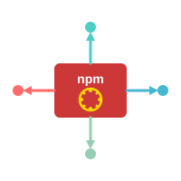

<p align="center">
  
</p>

<h1 align="center">Always Up To Date</h1>

<p align="center">
  Dependency updates that respect your package.json: ranges are followed, exact pins stay put, and you decide how far past them to go.
</p>

<p align="center">
  <a href="https://github.com/pixel-perfect-software/always-up-to-date/actions/workflows/ci.yml"></a>
  <a href="https://www.npmjs.com/package/@pixel-perfect-software/always-up-to-date"></a>
  
  
  
  <a href="LICENSE"></a>
</p>

`autd` updates your dependencies the way your package manager would. Run `autd update` and each
dependency moves to the newest version its package.json range allows, the same set `npm update`
installs, while an exact pin like `"18.2.0"` stays exactly where it is. When you want more, a
small config file lets one package, a scope, or everything move past its range.

It works with npm, pnpm, yarn and bun, in single projects and workspaces, and uses the package
manager your package.json declares, or the one your lockfile belongs to.

```console
$ autd update --dry-run

Would update (16 packages)
  axios       1.4.0   → 1.20.0
  commander   9.0.0   → 9.5.0
  debug       4.3.1   → 4.3.7
  zod         3.20.0  → 3.25.75  3.25.76 held by cooldown (1d old, needs 2d)
  …

Held by cooldown (1 package)
  ms          2.1.2   → 2.1.3    released 1d ago, needs 2d

Outside the range in package.json (5 packages)
  "beyondRange": "major" in .always-up-to-date.json would allow them
  express     4.17.1  → 5.3.0    major
  react       18.2.0  → 19.3.1   major
  typescript  5.0.4   → 7.0.2    major
  …

16 to update · 1 held by cooldown · 5 outside the range
Run autd update to apply.
```

In a terminal, each new version is colored from the part that changes: red for a major step, yellow for a minor one, green for a patch. A move outside the range rewrites the range in `package.json` (or the catalog, which the row names, as `catalog:default`), and the report says so. A warning from a `latest` rule (a license change, a deprecation, a peer conflict, an engines hold) is yellow, behind a `!`. Ages past a year show in years (`2.1y`). Emoji and the `!` marker follow the terminal: a pipe, a redirect or `NO_COLOR` gets plain text. The `beyondRange` hint counts what the level lets through the range; cooldown, peer, license, deprecation and engines holds still apply after it. The last line repeats the run's `--pm` and `--no-cache`. After `update`, the summary line says how long it took.

`check` prints the same report, and `update` prints it once more after the package manager has run, with what it actually installed. Every package shows up once, under what happened to it: updated, left in place by the package manager, held by cooldown, outside its range, or held by a rule, an override, a peer conflict, a deprecation or a license change.

What happens to each kind of spec:

| In package.json | Installed | Latest | `autd update`             | With `"beyondRange": "major"` |
| --------------- | --------- | ------ | ------------------------- | ----------------------------- |
| `"^9.0.0"`      | 9.0.0     | 15.0.0 | 9.5.0, the newest `9.x`   | `"^15.0.0"`                   |
| `"~4.3.1"`      | 4.3.1     | 4.4.3  | 4.3.7, the newest `4.3.x` | `"~4.4.3"`                    |
| `"18.2.0"`      | 18.2.0    | 19.3.1 | stays on 18.2.0           | `"19.3.1"`, still exact       |

## ✨ Features

- 📏 **Follows your ranges.** By default an update installs what the package manager itself would, and an exact pin is never touched.
- 🎚️ **Goes further when you say so.** `beyondRange` lets everything move past its range by a patch, minor or major step; per-package `rules` hold a package, keep it in range, or always take the latest, by name or `*` glob.
- 🛡️ **Holds what would break.** A package your package manager pins with an override is left alone, and so is an update an installed package's peer range would reject. Each one is reported with the reason.
- ⏳ **Waits out fresh releases.** `cooldown` skips versions published more recently than a number of days, a duration like `"1 week"`, or a limit per update type.
- ✍️ **Keeps package.json yours.** Decorators, `npm:` aliases and compound ranges keep their shape, and the file keeps its indentation, line endings and final newline.
- 🤖 **Fits in CI.** `--json` prints one versioned JSON document with a schema, and a failed step exits 1 with its name.

## 📋 Requirements

- **Node.js** 22.23 or later on 22, or 24.17 or later
- **npm**, **pnpm**, **yarn** (v1, or 2+ with the PnP or `node-modules` linker) or **bun**.

## 🚀 Install

```bash
npm install -g @pixel-perfect-software/always-up-to-date
```

The command is `autd`; `alwaysuptodate` and `always-up-to-date` work too.

## 🧭 Getting started

```bash
autd check              # list outdated dependencies
autd update --dry-run   # see where each one would move, or why it's held
autd update             # apply it
autd init               # optional: create .always-up-to-date.json to go past your ranges
```

## ⌨️ Commands

| Command                                                   | Description                                                                                                 |
| --------------------------------------------------------- | ----------------------------------------------------------------------------------------------------------- |
| `autd check`                                              | List outdated dependencies                                                                                  |
| `autd check --json`                                       | The same rows `update --dry-run` plans, as a versioned JSON document (see [JSON output](#-json-output))     |
| `autd update`                                             | Update every eligible dependency                                                                            |
| `autd update [packages...]`                               | Update only the named packages                                                                              |
| `autd update --dry-run`                                   | Show where each package would move, or why it's held, without changing anything                             |
| `autd update -i, --interactive`                           | Pick the packages to update from a checklist                                                                |
| `autd update --json`                                      | Print the update results as a versioned JSON document (combines with `--dry-run`, not with `--interactive`) |
| `autd check --no-cache`, `autd update --no-cache`         | Ask the registries instead of using autd's cache (see [Cache](#-cache))                                     |
| `autd check --pm <manager>`, `autd update --pm <manager>` | Use `npm`, `pnpm`, `yarn` or `bun` instead of detecting the manager                                         |
| `autd init`                                               | Create `.always-up-to-date.json` in the nearest package.json's directory                                    |
| `autd help [command]`                                     | Show the commands, or one command's options                                                                 |

## 🧾 JSON output

`check --json`, `update --dry-run --json` and `update --json` print one JSON document on stdout and nothing else: progress is dropped, and errors, warnings and debug lines go to stderr. `check --json` plans the way `update --dry-run --json` does, so both print the same `rows`. [`schema/output.schema.json`](schema/output.schema.json) (JSON Schema draft-07) describes every document. It stays open where 4.x may grow: objects allow additional properties and `reason.code` is any string, with the codes 4.0.0 defines listed as `examples`, so a copy of the schema from one 4.x release validates the documents of a later one. `version`, `command`, `phase` and `outcome` are closed.

```json
{
  "version": 1,
  "autd": "4.0.0",
  "command": "check",
  "phase": "plan",
  "manager": "npm",
  "member": null,
  "rows": [
    {
      "name": "ms",
      "workspace": ".",
      "current": "2.0.0",
      "wanted": "2.1.3",
      "latest": "2.1.3",
      "target": "2.1.3",
      "updateType": "minor",
      "outcome": "update",
      "reason": { "code": "within-range", "message": "within range" },
      "warnings": [],
      "releaseAgeDays": null
    }
  ]
}
```

| Field                   | Meaning                                                                                                                 |
| ----------------------- | ----------------------------------------------------------------------------------------------------------------------- |
| `version`               | The format's version, `1`                                                                                               |
| `autd`                  | The version of autd that printed it                                                                                     |
| `command`               | `check` or `update`                                                                                                     |
| `phase`                 | `plan` for `check` and `update --dry-run`; `applied` for `update`, also when nothing moved                              |
| `manager`               | The package manager the run used                                                                                        |
| `member`                | The workspace member the run started from, or `null`                                                                    |
| `rows[].name`           | The package name as the manifest names it                                                                               |
| `rows[].workspace`      | The manifest's directory relative to the project root; `.` for the root and for a single package                        |
| `rows[].current`        | The installed version, or `null` when it isn't installed                                                                |
| `rows[].wanted`         | The highest version the range allows                                                                                    |
| `rows[].latest`         | The registry's latest version                                                                                           |
| `rows[].target`         | The version the row moves to, or `null` when it is held                                                                 |
| `rows[].updateType`     | The semver step (`major`, `minor`, `patch`, a `pre` variant, `prerelease`), or `null`                                   |
| `rows[].outcome`        | What happens to the row, below                                                                                          |
| `rows[].reason`         | `{ code, message }`: why the row moves or is held, on every row. `message` is the text the report shows; don't parse it |
| `rows[].warnings`       | `[{ code, message }]`: problems the row moved despite, such as a `"latest"` rule over a peer conflict. Always an array  |
| `rows[].releaseAgeDays` | The age in days of the release the cooldown judged, or `null` when nothing judged the row                               |

The four outcomes:

| `outcome`      | Meaning                                                                        |
| -------------- | ------------------------------------------------------------------------------ |
| `update`       | The row moves (in a plan) or moved (after `update`)                            |
| `held`         | The plan leaves it where it is; `reason` says why                              |
| `not-applied`  | `update` asked the manager to move it and the manager left it below its target |
| `not-targeted` | `update <packages>` named other packages                                       |

The `reason.code` values:

| Outcome                       | Codes                                                                                                                                                                                                                         |
| ----------------------------- | ----------------------------------------------------------------------------------------------------------------------------------------------------------------------------------------------------------------------------- |
| `update`                      | `within-range`, `past-range` (a `beyondRange` level moved it past the range), `rule-latest`, `cooldown-fallback` (an older version, because the newest is too fresh), `engines-fallback` (npm's newest version its Node runs) |
| `held`                        | `invalid-version`, `not-installed`, `not-newer`, `rule-hold`, `rule-follow-range`, `outside-range`, `override`, `peer-conflict`, `target-peers`, `cooldown`, `deprecated`, `license-change`, `engines`, `held-with`           |
| `not-applied`, `not-targeted` | the code of the same name                                                                                                                                                                                                     |

Within version 1, 4.x releases may add fields and reason codes without changing `version`. Branch on `outcome`, and treat a code you don't know like its outcome. A change that removes or renames a field, or changes what one means, bumps `version`.

A failed command prints an error document and exits 1:

```json
{
  "version": 1,
  "autd": "4.0.0",
  "command": "update",
  "error": { "step": "apply", "message": "…", "manifestWritten": true }
}
```

`step` is `detect`, `discover` or `apply`, or `null` for a failure outside a step, such as a malformed config. `manifestWritten` is `true` when a package.json was already rewritten when the manager failed.

## ⚙️ Configuration

You only need a config file to go further than your package.json ranges. Run `autd init` to create
`.always-up-to-date.json` in your project root (run from a workspace member, it creates the member's own file; see [Running from a workspace member](#running-from-a-workspace-member)):

```json
{
  "$schema": "https://raw.githubusercontent.com/pixel-perfect-software/always-up-to-date/main/schema/config.schema.json",
  "beyondRange": "none",
  "rules": {},
  "cooldown": 0,
  "debug": false,
  "silent": false
}
```

| Option        | Default  | Description                                                                                                                                                                                                                                                                                                                                                                                                                                 |
| ------------- | -------- | ------------------------------------------------------------------------------------------------------------------------------------------------------------------------------------------------------------------------------------------------------------------------------------------------------------------------------------------------------------------------------------------------------------------------------------------- |
| `beyondRange` | `"none"` | How far past its range a dependency may move, to its latest version: `"none"`, `"patch"`, `"minor"` or `"major"`. Applies to exact pins too, so `"patch"` moves `"1.11.9"` to `"1.11.23"`.                                                                                                                                                                                                                                                  |
| `rules`       | `{}`     | Per-package overrides (see below).                                                                                                                                                                                                                                                                                                                                                                                                          |
| `cooldown`    | `0`      | Skip versions published more recently than this: days (`7`), a duration (`"1 week"`, `"24h"`), or per update type (`{ "major": "30 days" }`). A package whose newest version is too fresh moves to the newest one that is old enough and that its range in package.json allows, and is held only when there is none. A version whose publish date can't be found is held too.                                                               |
| `depsDev`     | `true`   | Look up versions of packages on the public npm registry (registry.npmjs.org, registry.yarnpkg.com) through [deps.dev](https://deps.dev), which is much smaller than the registry's own documents. Each such package name is sent to api.deps.dev, **including private packages published to registry.npmjs.org**; set `false` to read everything from the registry. Names from any other registry, including a scope's own, are never sent. |
| `debug`       | `false`  | Print each package-manager command and its stderr.                                                                                                                                                                                                                                                                                                                                                                                          |
| `silent`      | `false`  | Suppress all output.                                                                                                                                                                                                                                                                                                                                                                                                                        |

autd checks the file. A `cooldown` it can't read (`"30 dyas"`, `-3`), a `debug` or `silent` that isn't `true` or `false`, or a file that isn't a JSON object fails `check` and `update` with a message that names the key and the value. An unknown key is a warning that names it and the nearest known key (`beyondrange`: did you mean `beyondRange`?).

### Rules

`rules` overrides the policy for single packages or groups:

```json
{
  "beyondRange": "minor",
  "rules": {
    "react": "hold",
    "typescript": "latest",
    "@types/*": "followRange"
  }
}
```

| Rule            | Effect                                                              |
| --------------- | ------------------------------------------------------------------- |
| `"hold"`        | Never update this package.                                          |
| `"followRange"` | Stay within the range, even when `beyondRange` allows more.         |
| `"latest"`      | Always move to the latest version, whatever the range or step size. |

Keys are package names or `*` globs (`"@types/*"`, `"eslint-*"`, `"*"`). An exact name beats a glob, and among globs the longest pattern wins.

### What else holds an update

- **Installed peer ranges.** An update an installed package's peer range would reject is held, naming that package: `react` stays on 18 while `@tanstack/react-query` 4, which accepts react up to 18, stays installed. A `"latest"` rule still moves it, with a warning.
- **Overrides.** A package your package manager pins with an override is held when the update would leave the override's range, with the reason `controlled by …`. That covers npm `overrides`, yarn berry `resolutions`, pnpm `overrides` in `pnpm-workspace.yaml`, and bun `overrides` or `resolutions`.

### How specs are rewritten

When a dependency moves past its range, its spec keeps its decorator: `"^18.2.0"` becomes `"^19.3.1"` and `"1.11.9"` becomes `"1.11.23"`. A spec that can't keep its shape, such as `"3.x"` or `">=4 <5"`, is written the way your package manager writes a new dependency: `^` unless you set `save-exact` / `save-prefix` (npm), `saveExact` / `savePrefix` (pnpm), `defaultSemverRangePrefix` (yarn) or `exact` (bun).

## 📦 Package managers and workspaces

autd uses the first of these that names a manager: the `--pm` option, the `packageManager` field in package.json (`"pnpm@12.14.0"`, as Corepack reads it), `devEngines.packageManager`, then the lockfile. A lockfile from another manager than the declared one is ignored, with a warning when the declared manager has no lockfile of its own. With several lockfiles and nothing declared, autd warns and picks in the order bun, pnpm, yarn, npm.

| Manager          | Lockfile            | Workspaces from                                                  |
| ---------------- | ------------------- | ---------------------------------------------------------------- |
| npm              | `package-lock.json` | the `workspaces` field in package.json                           |
| pnpm             | `pnpm-lock.yaml`    | the `packages` list in `pnpm-workspace.yaml`, including catalogs |
| yarn (v1 and 2+) | `yarn.lock`         | the `workspaces` field in package.json                           |
| bun              | `bun.lock`          | the `workspaces` field in package.json, including catalogs       |

In a workspace, autd plans each package once per manifest that declares it, and `--json` has one row per package and manifest, each with a `workspace` (`.` is the root, also in a single-package project). A package that moves past its range is rewritten in the manifest that declares it; if that spec is a `catalog:` reference, the catalog entry is rewritten instead. A package that can move in one manifest but is held in another (a cooldown, a peer conflict, an override) is held everywhere, with the reason `held with <path> (…)`, so the manifests don't drift apart.

### Running from a workspace member

Run `check` or `update --dry-run` from a member's directory (or any directory inside it) and autd covers that member's manifest only. It finds the workspace root that lists the member and detects the manager from the root's lockfile and the root's `packageManager`, unless the member declares its own, and `check --json` lists only that member's rows, with `member` naming the directory. The config is the member's own `.always-up-to-date.json` if it has one, else the workspace root's; the two are not merged. A pnpm directory with its own `pnpm-workspace.yaml`, or one no workspace lists, is a project of its own. Yarn 2+ refuses a directory its root doesn't list, and so does autd.

`update` is refused from a member. Every manager writes one lockfile for all workspaces and can move other workspaces' copies of a package, so an update is never limited to one member. Run `autd update` in the workspace root; `autd update --dry-run` in the member previews that member's updates.

## 🗄️ Cache

autd keeps what it learns from the registries (each package's latest version, the list of its versions, and when versions were published, for `cooldown` and a manager's release-age setting) so a second `check` within five minutes asks nobody. The folder is `ca.pixel-perfect.alwaysuptodate` in:

- `~/Library/Caches/` on macOS
- `$XDG_CACHE_HOME` if it is an absolute path, else `~/.cache`, on Linux and other Unixes
- `%LOCALAPPDATA%` on Windows

It holds derived version lists only, never a registry document, a header or anything about your credentials. Latest versions are kept for 5 minutes and deps.dev lists for an hour; a registry's own `Cache-Control` can shorten that. A stale package document is checked with the registry (`If-None-Match`) rather than downloaded again. An answer from a registry you authenticate to is reused without asking only when the package is also public on deps.dev; otherwise autd asks the registry each time (a cheap `304` when nothing changed). Publish dates never change, so a stored package document that already lists every version autd needs a date for is reused whatever its age, unless the registry needs credentials or says to check each time. autd downloads a package's full document only for a date the lookup didn't give: on the public npm registry, for versions deps.dev has not indexed yet; on any other registry or with `depsDev: false`, for the versions a cooldown or a release-age setting judges. The folder stays under 32 MiB, dropping the least recently used entries.

- `--no-cache` on `check` or `update`, or `AUTD_NO_CACHE` set to anything but empty, `0` or `false` (`1` and `true` both work), reads and writes nothing.
- `AUTD_CACHE_DIR=<path>` puts the folder somewhere else; autd only writes inside its `v1/` subfolder.
- Deleting the folder is always safe.

## 🩺 Troubleshooting

- **A package isn't updating.** Run `autd update --dry-run`: every held package shows why. The report words it as `outside the range` (with the step, `major`), `rule "hold"`, `held by an override`; `--json` carries the longer messages, such as `major beyond the range`, `held by rule`, `controlled by overrides (…)`, `peer conflict: …`, `deprecated: …` or `license change: MIT → AGPL-3.0-or-later`. After `autd update`, a package your manager was asked to move but left where it was is listed under "left in place by …" and reported with `"outcome": "not-applied"` and `not applied by npm (installed …)`. npm does this to a package another dependency pins exactly, and to a workspace member's copy it dedupes onto the root's. In a workspace, `held with <path> (…)` means the same package is held in that manifest, so its other manifests wait for it.
- **`check` or `update` exits 1.** The message names the step that failed (`detect`, `discover` or `apply`) and says whether package.json was already written. Set `"debug": true` to see each package-manager command and its stderr.
- **"No package manager detected".** package.json declares no manager and there's no lockfile in the current directory (from a workspace member: no package.json from the member's up to the workspace root's declares one, and the workspace root has no lockfile). Set `"packageManager"`, pass `--pm`, or run your package manager's install first.
- **`cooldown` holds a package with `release date unknown`.** autd couldn't read that version's publish time from the registry. It reads `.npmrc` the way npm does: registries and scoped registries, per-registry auth, `ca` / `cafile` / `strict-ssl`, `https-proxy` / `proxy` / `noproxy`, `fetch-retries`, `fetch-timeout` and `maxsockets`. SOCKS proxies aren't supported. Set `"debug": true` to see the request that failed.
- **The wrong package manager runs.** A leftover lockfile decided it. Set `"packageManager"` in package.json or pass `--pm`; with `"debug": true`, autd logs which lockfiles it ignored.

## 🔄 Upgrading from 3.x

4.0 versions the `--json` output and gives every command the same document. If a script reads it, update it:

| 3.x                                                                    | 4.0                                                                                              |
| ---------------------------------------------------------------------- | ------------------------------------------------------------------------------------------------ |
| `check --json` printed an object keyed by package name                 | A document with `rows`, the rows `update --dry-run --json` prints; `check --json` now plans      |
| `update --json` and `--dry-run --json` printed an array of rows        | A document with `rows`, `version`, `autd`, `command`, `phase`, `manager` and `member`            |
| `--dry-run --json` printed `[]` when nothing was outdated              | The document with `"rows": []`                                                                   |
| `"updated": true` / `false`                                            | `"outcome"`: `update`, `held`, `not-applied` or `not-targeted`                                   |
| `"reason": "…"`, absent on a moving row                                | `"reason": { "code", "message" }` on every row; `message` is the old text                        |
| `"warning": "…"`                                                       | `"warnings": [{ "code", "message" }]`, always an array                                           |
| `target` absent on a held row                                          | `"target": null`                                                                                 |
| `workspace` absent in a single-package project                         | `"workspace": "."`                                                                               |
| `"current": "missing"`                                                 | `"current": null`                                                                                |
| `releaseAge`                                                           | `releaseAgeDays`, `null` when nothing judged the row                                             |
| `workspaces: [{ path, current, wanted }]` in the `check --json` record | One row per manifest, each with its `workspace`                                                  |
| `{ "error": { "step", "message", "manifestWritten" } }`                | The same inside a document with `version`, `autd` and `command`; `step` is `null` outside a step |

## 🔄 Upgrading from 1.x

2.0 changed what `autd update` does with no config. 1.x moved any dependency with a newer patch release, rewriting exact pins to `^`, and held minor updates even when the range allowed them. 2.0 installs what the range allows and leaves exact pins alone. To let pins take patch releases again, set `"beyondRange": "patch"`.

Old config files keep working. When both are set, `beyondRange` and `rules` win:

| Old field                   | Same as                      |
| --------------------------- | ---------------------------- |
| `"allowMinorUpdates": true` | `"beyondRange": "minor"`     |
| `"allowMajorUpdates": true` | `"beyondRange": "major"`     |
| `"updateAllowlist": ["x"]`  | `"rules": { "x": "latest" }` |
| `"updateDenylist": ["x"]`   | `"rules": { "x": "hold" }`   |

See [CHANGELOG.md](CHANGELOG.md) for everything in each release, and the [roadmap](docs/roadmap.md) for what's next.

## 🤝 Contributing

Contributions are welcome! See the [Contributing Guide](docs/contributing.md) to get started.

## 💸 Support this project

<a href="https://www.buymeacoffee.com/tylernrobertson" target="_blank"></a>

## 📝 License

MIT © [Tyler Robertson](https://github.com/TylerNRobertson) @ [Pixel Perfect Software Inc.](https://github.com/pixel-perfect-software). See [LICENSE](LICENSE) for details.
